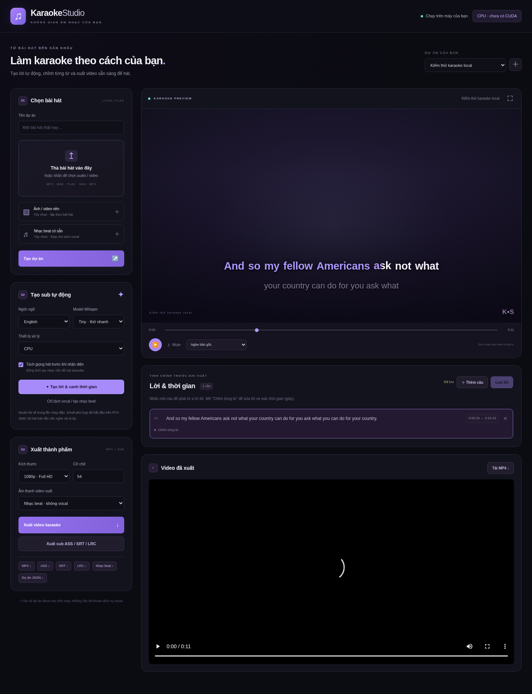

# Karaoke Sub — Studio karaoke chạy local

Bản tùy biến từ [Nomad Karaoke / karaoke-gen](https://github.com/nomadkaraoke/karaoke-gen), dành cho **Windows 10/11 + NVIDIA RTX 3060**. Giao diện tiếng Việt, xử lý bài hát trên máy, không cần tài khoản hay API trả phí.



## Bắt đầu trên Windows

1. Tải ZIP của repo này và giải nén vào đường dẫn ngắn, ví dụ `D:\Karaoke_Sub`.
2. Cài **Python 3.11 64-bit**, bật tùy chọn **Add Python to PATH**; cập nhật driver NVIDIA.
3. Nhấp đúp **`windows\setup.bat`** để cài môi trường và kiểm tra FFmpeg/CUDA. Cần Internet để tải thư viện và model lần đầu.
4. Nhấp đúp **`windows\start.bat`**. Trình duyệt mở `http://127.0.0.1:8765`.

[Xem hướng dẫn Windows, yêu cầu và xử lý lỗi](README-WINDOWS.md).

## Làm một bài karaoke

- Nhập bài hát từ MP3/WAV/FLAC hoặc video; tùy chọn thêm video/ảnh nền và beat có sẵn.
- Chọn tiếng Việt, thiết bị **Auto**, model **small**, rồi tạo lời tự động. Có thể tách giọng bằng **Demucs** trước khi nhận diện bằng **Whisper**.
- Nghe thử, sửa từng từ và thời gian bắt đầu/kết thúc, lưu lời. AI có thể nghe sai lời hát; kiểm tra trước khi xuất.
- Hát theo phần lời đổi màu. Chọn bài gốc hoặc nhạc không giọng; **Mute** tắt toàn bộ âm thanh nghe thử. Muốn bỏ giọng mà giữ nhạc, dùng **Tách vocal** hoặc nhập beat.
- Xuất **MP4 720p/1080p** với sub karaoke cháy chữ, nền lặp theo độ dài bài hát. Chọn âm thanh gốc, instrumental hoặc video không tiếng; Mute nghe thử không thay đổi lựa chọn âm thanh xuất.
- Tải thêm **ASS, SRT, LRC**, và JSON của dự án. Dự án và file được lưu trong `.local-data/projects`; giữ cả thư mục để tiếp tục chỉnh sửa. JSON chỉ chứa lời và thông tin, không chứa các tệp media.

GPU dùng cho tách giọng và nhận diện; xuất video dùng FFmpeg/libx264 trên CPU. Model `small` là mặc định an toàn cho RTX 3060 6 GB; `medium` phù hợp khi đủ VRAM. Nếu hết VRAM, đóng ứng dụng chiếm GPU, giảm model hoặc chọn CPU.

## Kiến trúc

Chế độ mới nằm trong `local_studio/`: API FastAPI chạy ở loopback, giao diện HTML/CSS/JavaScript, Whisper-timestamped, Demucs và FFmpeg. Bộ cài dùng **`requirements-local.txt`**; không cài toàn bộ backend cloud của bản gốc. Không cần Docker, Google Cloud, Stripe hoặc khóa API để sử dụng chế độ này. Lần đầu thư viện AI tải trọng số từ Internet, các lần sau dùng cache local.

Chạy thủ công sau khi cài dependency/FFmpeg:

```console
python -m local_studio
python -m local_studio --no-browser --port 8765
```

## Mã nguồn gốc và giấy phép

Nguồn: `nomadkaraoke/karaoke-gen`, commit `d59b5bf3bd05a434563e38bb8bd18ee856cc4ac6`, phiên bản `0.294.2` tại thời điểm lấy mã. Giữ nguyên giấy phép [MIT của Nomad Karaoke LLC](LICENSE). Tài liệu và CLI gốc ở [README-UPSTREAM.md](README-UPSTREAM.md). Phần studio local được bổ sung cho repo `vn8690-create/Karaoke_Sub`.

Các workflow triển khai cloud của upstream được lưu tại `docs/upstream-workflows/` thay vì tự chạy trong repo này. Workflow riêng của studio kiểm tra API, phụ đề và xuất video với dữ liệu tổng hợp; không cần API key hay GPU.

## Kiểm thử

```console
python -m unittest discover -s tests/local_studio -v
```

Các kiểm thử tích hợp cần FFmpeg/ffprobe có libass và libx264. Kiểm thử nhanh dùng dữ liệu tổng hợp, không tải model AI. Kết quả xác minh thực tế và các giới hạn nằm ở [LOCAL-TEST-REPORT.md](LOCAL-TEST-REPORT.md).
